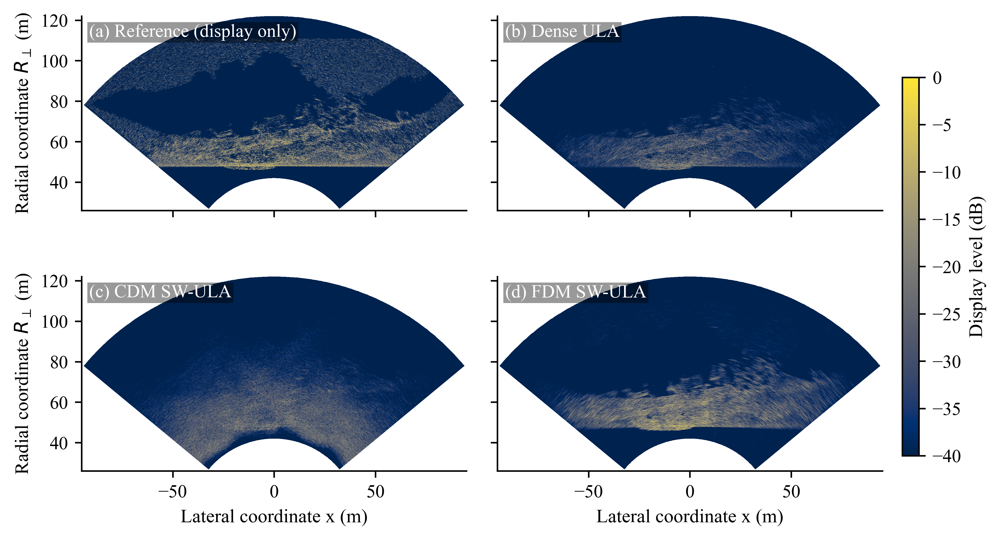
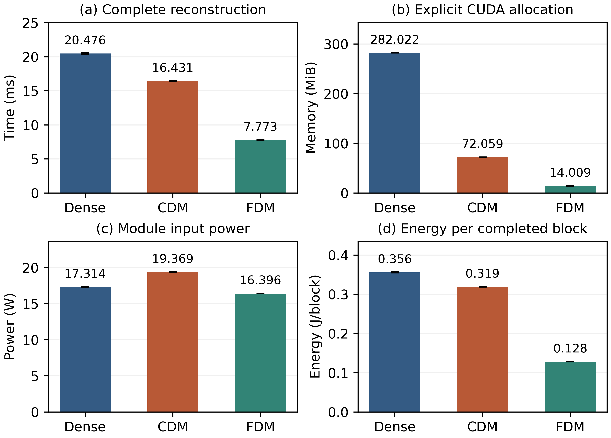

# Sectorized Multibeam Sonar Imaging With a Super-Wavelength Uniform Linear Receive Array

Code and data accompanying the article by Qiuming Ai, Jie Huang, Chunru Wan, and Jun-Hong Cui, published in *Results in Engineering*, **32** (2026), 113776. [Read the article](https://doi.org/10.1016/j.rineng.2026.113776).

The study compares a 128-channel dense reference with 32-channel CDM and FDM implementations over a 100° field of view. Image data are simulated. Jetson Orin NX measurements are receive-processing benchmarks on synthetic-echo replay, not acoustic acquisitions or full-sonar timing or power measurements.

## Results at a glance



**Figure 13. Simulated shipwreck scene.** The geometry-derived reference is display only. The three reconstructions share an amplitude reference and display range; the example uses common per-element noise at a 10 dB Dense-reference input SNR.



**Figure 15. Jetson Orin NX processing benchmark.** The panels show reconstruction time, explicit CUDA allocation, module input power and energy per block for synthetic-echo replay. Mean reconstruction times were 20.48 ms (Dense), 16.43 ms (CDM), and 7.77 ms (FDM).

### Cite the paper

```bibtex
@article{ai2026sectorized,
  author  = {Ai, Qiuming and Huang, Jie and Wan, Chunru and Cui, Jun-Hong},
  title   = {Sectorized Multibeam Sonar Imaging With a Super-Wavelength Uniform Linear Receive Array},
  journal = {Results in Engineering},
  year    = {2026},
  volume  = {32},
  pages   = {113776},
  doi     = {10.1016/j.rineng.2026.113776}
}
```

## Start here

From the repository root, in a virtual environment with Python 3.11 or newer:

```sh
python -m pip install -r requirements.txt
python scripts/check_release.py
python code/jetson/verify_records.py
python code/design/plot_design.py --output outputs/design
python code/plots/figure05/plot_figure5_legend.py
python code/wave_spatial/plot_final_figures.py
python code/scenes/plot_submission_figures.py
python code/plots/plot_density_main.py
python code/plots/redraw_figure14_bars.py
```

These commands verify the bundled evidence and replot Figures 2–5, 7–12 and 14 from saved data or archived analytical recipes. For the two figures shown above, go to [Download the data and reproduce Figures 13 and 15](#download-the-data-and-reproduce-figures-13-and-15). The plotters write only under `outputs/`; they do not generate new echoes or rerun hardware. See [design and explanatory figures](code/design/README.md), [Jetson build, replay and measurements](code/jetson/README.md), and the [figure/table map](docs/evidence-map.md). Platform fonts, PDF metadata and timestamps can differ; compare data and statistics, not regenerated PDF hashes.

## Run the numerical models

```sh
python code/scenes/run_final_scenes.py --suite gates
python code/scenes/run_final_scenes.py --suite point --out outputs/point_rerun
python code/scenes/run_final_scenes.py --suite dense --out outputs/dense_rerun
python code/scenes/nms_sensitivity.py --noise-cache outputs/point_rerun/point30m/independent_test_noise_images.npz
python code/coverage/run_coverage.py
python code/wave_spatial/run_wave_spatial.py --only window
python code/wave_spatial/run_wave_spatial.py --only ambiguity two_way
python code/density_snapshot/common/scene_noise.py --suite density
python code/common/competitive.py --min-spacing-width
```

The gates are short numerical consistency checks. Full runs can take several minutes or longer, and can generate hundreds of MB of intermediate arrays. Run into fresh directories. The density figure uses a distinct frozen historical numerical core; do not substitute the later point/dense core. The DAS/OMP check compares identical simulated measurements within each grid and uses a shared DAS-calibrated detector threshold, not equal false-alarm calibration. Its CPU times are machine-dependent.

## What the data contain

- CSV: per-trial or per-condition records, with units in field names where applicable. Read UTF-8 with optional BOM. `all_trials.csv` and `summary_mean_ci.csv` are different levels of evidence. Columns ending in `ci95_halfwidth` are **half-widths** of two-sided confidence intervals for means.
- NPZ: numeric arrays. Load with `numpy.load(path, allow_pickle=False)`. Point-scene image arrays are complex, shaped `[range, angle]`, with `ranges_m` and `angles_deg` coordinate vectors. Display normalization is performed only during plotting.
- `data/inputs/dense1000x50_source.npz`: the fixed simulated complex reflectivity grid, extracted without numerical conversion from cell `scenes{2}` of the original A10 MATLAB workspace. No unrelated MATLAB workspace variables are included.
- The point and fixed dense scenes each have 30 paired noise trials **per SNR and noise rule**. Figure 12 instead uses three independently generated, noise-free scenes per condition. The shipwreck statistics use 30 phase/noise realizations of one fixed model geometry, not 30 different wrecks.
- A SHA-256 manifest covers the staged files. It does not certify licensing or reproduce timing on a different board.

## Download the data and reproduce Figures 13 and 15

Download these two assets from [Release v0.10.0](https://github.com/Qiuming-Ai/sectorized-swula-sonar/releases/tag/v0.10.0):

- [Shipwreck data — `shipwreck-data_v10.zip` (435 MB)](https://github.com/Qiuming-Ai/sectorized-swula-sonar/releases/download/v0.10.0/shipwreck-data_v10.zip): the author-generated STL, archived arrival catalogue, and saved image arrays for Figure 13.
- [Desktop MATLAB timing data — `desktop-timing-data_v10.zip` (102 MB)](https://github.com/Qiuming-Ai/sectorized-swula-sonar/releases/download/v0.10.0/desktop-timing-data_v10.zip): three synthetic HDF5 inputs for the historical desktop timing replay. **Figure 15 does not use this ZIP**: the Jetson measurements are already in `data/jetson/`.

Save the ZIPs **outside** the checkout so the repository checksum test does not treat them as unexpected files. If both ZIPs are in the parent directory of your checkout, run these commands **from the repository root**, after installing the requirements above:

```sh
python -m zipfile -e ../shipwreck-data_v10.zip .
python -m zipfile -e ../desktop-timing-data_v10.zip .
python scripts/check_release.py --shipwreck --desktop-timing
python code/scenes/plot_shipwreck.py
python code/jetson/plot_paper_figure15.py
```

The ZIPs already contain the directory structure: the extracted files land in `data/shipwreck/geometry/` and `data/desktop-timing/overlay/`. A successful checksum run reports `"status": "pass"`, with **5** shipwreck files and **3** desktop timing files verified. Use only the flag for the asset you extracted if you downloaded just one.

- Figure 13 is written as PDF, PNG, and SVG under `outputs/figures/` with the stem `shipwreck_common_per_element_noise_common_scale`.
- Figure 15 is written as PNG and SVG under `outputs/jetson/paper/` with the stem `figure15_jetson_resources`. For another run, use `--out outputs/jetson/paper_repeat01` or another new directory; the plotter does not overwrite existing figures.

Neither replot needs MATLAB, a CUDA toolchain, or a Jetson. For a new numerical shipwreck run, use `python code/scenes/run_final_scenes.py --suite ship --out outputs/ship_rerun`; it starts from the supplied arrival catalogue, not the STL. See the [shipwreck data notes](data/shipwreck/README.md) and [desktop timing data notes](data/desktop-timing/README.md) for provenance and scope.

## MATLAB experiments

See the [MATLAB guide](matlab/README.md) for the A1–A19 experiments, shared helpers, historical SonarSim examples, desktop timing, and the shipwreck MATLAB/CUDA MEX build path. These are the MATLAB sources associated with the study, not a MATLAB port of the final Python imaging and statistics. Jetson replay uses C++/CUDA.

## Release boundaries and license

Large author-generated intermediate arrays (including the point-noise bank and complete ambiguity bank) are not bundled. The relevant tables, exact figure inputs and code are provided instead. The point runner generates the noise bank, and the ambiguity runner generates the complete ambiguity bank. Raw remote access scripts, credentials, device identifiers, binaries, reviewer correspondence and manuscript PDFs are not included.

The project code and the author-generated shipwreck STL and geometry-derived datasets are released under the [Apache License, Version 2.0](LICENSE). This does not change the license of the published article or of separately installed dependencies. No additional license is asserted for other archived datasets or measurements.
